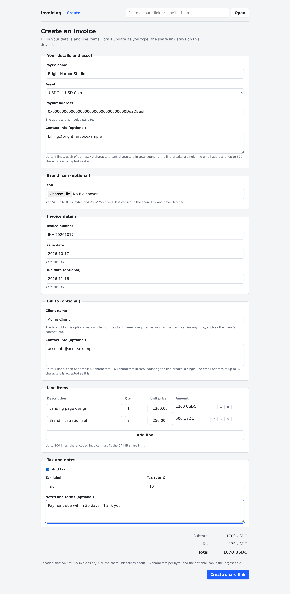
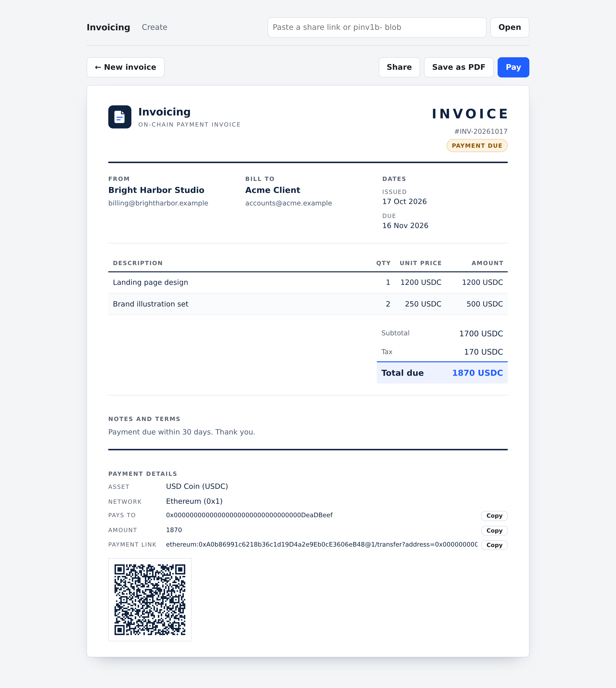
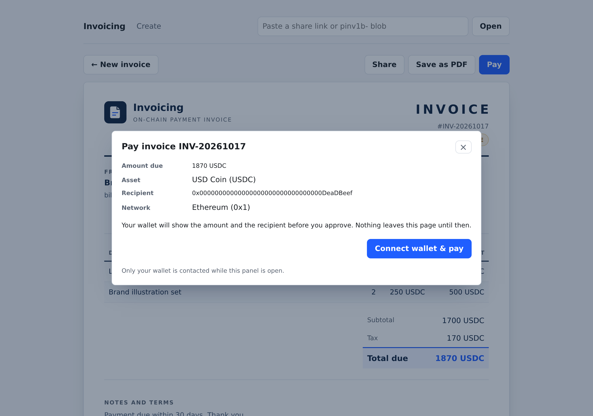
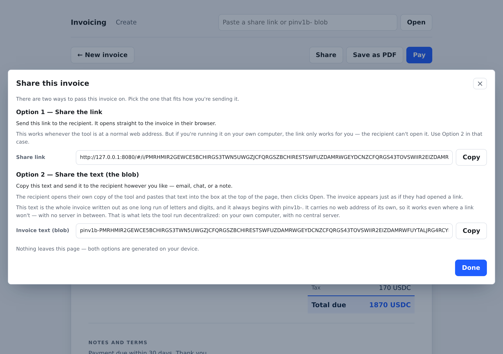

# Invoicing & Payment App

Make an invoice in your browser, share it as a link, and get paid in crypto.

## What it is

Create an invoice with your own line items, tax, and logo.
Share it as a link, and the person you bill opens a clean invoice they can pay.
There is nothing to install and no account to create.

## Screenshots

*Fill in your details, add line items, and share the invoice by link.*

*A shared link opens as a finished invoice the person you bill can pay.*

*Pay restates the transfer before you connect a wallet.*

*Share gives you a link or a code you can paste anywhere.*

## What you can do

- Create an invoice with line items and tax.
- Add your own logo.
- Share the invoice as a link or a copy-paste code.
- Let the person you bill see a clean invoice, with a scannable QR code and a payment link.
- Save the invoice as a PDF.
- Take payment from a crypto wallet in Ethereum, USDC, or USDT.
- Scan a QR code to pay in Zcash or Monero.

## Privacy by design

- No account and no sign-up.
- No cookies, no tracking, and no analytics.
- Nothing is uploaded, because the invoice travels inside the link itself and never reaches a server.
- The app is a set of static files with no backend.

## Open the app

All three links open the same app, so pick the one that suits how you browse. If you do not know what IPFS is — a network that serves files from many computers rather than one company — use the first one.
The long code starting `bafybei…` names the same content in all three, so the copy you are served can be checked against it.

- **Most people:** <https://bafybeic2zbzrhdemxr7c5vfnvshwo4qfap7uolqyot3qlqhusxage4pmv4.ipfs.zoltu.io/> works in any browser, because a public service serves it for you; that service is run by someone else and could change the files before serving them, so trust it only as far as you trust its operator.
- **Already use IPFS:** <ipfs://bafybeic2zbzrhdemxr7c5vfnvshwo4qfap7uolqyot3qlqhusxage4pmv4> opens the same app through your own IPFS software.
- **Run your own IPFS node:** <http://bafybeic2zbzrhdemxr7c5vfnvshwo4qfap7uolqyot3qlqhusxage4pmv4.ipfs.localhost:8080/> serves the app from your own computer.

## License

This app is in the public domain under the [Unlicense](LICENSE).
